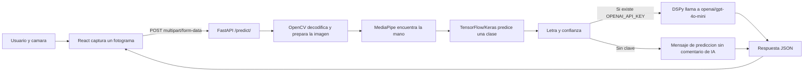

# Reconocimiento del alfabeto ASL

Aplicacion web local para capturar una seña con la camara, predecir una letra
del alfabeto ASL (American Sign Language) y, si hay una clave de OpenAI
configurada, solicitar comentarios adicionales a un modelo de lenguaje.

La prediccion visual la realiza un modelo TensorFlow/Keras guardado en
`asl_model.h5`. No la realiza el agente de IA: son dos componentes distintos.

## Contenido

- [Arquitectura general](#arquitectura-general)
- [Flujo de una prediccion](#flujo-de-una-prediccion)
- [Backend](#backend)
- [Frontend](#frontend)
- [Modelo de vision](#modelo-de-vision)
- [Agente de IA y proveedor](#agente-de-ia-y-proveedor)
- [Instalacion y ejecucion en Windows](#instalacion-y-ejecucion-en-windows)
- [API HTTP](#api-http)
- [Configuracion](#configuracion)
- [Limitaciones conocidas](#limitaciones-conocidas)
- [Solucion de problemas](#solucion-de-problemas)

## Arquitectura general



El backend y el frontend son procesos independientes. El navegador sirve la
interfaz en el puerto `5173`; FastAPI recibe las peticiones en el puerto
`8000`.

## Flujo de una prediccion

1. En la pagina, el usuario inicia la camara y selecciona la letra esperada.
2. React captura un fotograma del video en un `canvas` y lo convierte a JPEG.
3. Axios envia el archivo y la letra seleccionada como
   `multipart/form-data` a `POST /predict/`.
4. FastAPI decodifica los bytes con OpenCV y convierte la imagen de BGR a RGB
   para MediaPipe.
5. MediaPipe busca como maximo una mano. Si la encuentra, la API calcula un
   recorte a partir de sus puntos de referencia y agrega un margen de 20
   pixeles.
6. El recorte se redimensiona a `224 x 224`, se normaliza dividiendo sus valores
   entre `255` y se entrega al modelo Keras.
7. La API toma la clase con mayor puntuacion, la convierte a una letra cuando
   hay una etiqueta disponible y expresa la confianza como porcentaje.
8. La API intenta producir feedback con el agente descrito mas adelante. La
   prediccion del modelo es independiente de este paso.
9. El navegador muestra la letra, la confianza y el feedback recibido.

La letra que se selecciona en la interfaz es la referencia que se pasa al
agente para el feedback; **no obliga ni condiciona al clasificador**. El modelo
predice la clase que considera mas probable por la imagen.

## Backend

El backend esta escrito en Python y se define principalmente en estos archivos:

- `api.py`: crea la aplicacion FastAPI, configura CORS, carga el modelo y
  MediaPipe, y define el endpoint de prediccion.
- `agent.py`: prepara y solicita el feedback opcional con DSPy.
- `tools.py`: lee `gold_dataset/info.json` y obtiene la descripcion de una
  letra de referencia.
- `asl_model.h5`: modelo de clasificacion serializado de TensorFlow/Keras.
- `run_api.ps1`: lanzador recomendado en Windows para esta ubicacion del
  proyecto.

El modelo y el detector de MediaPipe se inicializan al importar `api.py`, es
decir, durante el arranque del servidor. Por eso el inicio puede tardar varios
segundos y mostrar mensajes de TensorFlow o MediaPipe antes de que la API este
lista. No son, por si solos, errores.

La API permite peticiones del frontend local desde `http://localhost:5173` y
`http://127.0.0.1:5173`. Si Vite informa otra direccion/origen, hay que agregar
ese origen a la lista `origins` de `api.py`.

## Frontend

El frontend esta en `frontend/asl_agent/` y utiliza:

- React y TypeScript para la interfaz y el estado de la pagina.
- Vite para el servidor de desarrollo y la compilacion.
- Axios para enviar la imagen a la API.
- React Router para las rutas de la pagina.
- Tailwind CSS para los estilos.

La pantalla de captura esta en `src/pages/Chat.tsx`. Utiliza
`navigator.mediaDevices.getUserMedia` para solicitar acceso a la camara, captura
un fotograma y muestra el resultado del backend. La URL base de Axios se
configura en `src/api/apiClient.ts`; toma `VITE_API_URL` o, si no esta definida,
usa `http://localhost:8000`.

## Modelo de vision

El archivo `asl_model.h5` contiene un modelo Keras cuya arquitectura y
dimensiones se inspeccionaron directamente:

- Arquitectura base: MobileNetV2.
- Entrada: imagen RGB de `224 x 224 x 3`.
- Cabeza de clasificacion: `GlobalAveragePooling2D`, `Dropout` de `0.3` y una
  capa `Dense` con activacion softmax.
- Salida guardada: 29 puntuaciones de clase.
- Parametros: 2,295,133 en total; 37,149 entrenables y 2,257,984 no
  entrenables.

El cuaderno `ProyectoFinal.ipynb` muestra el entrenamiento con MobileNetV2
preentrenado en ImageNet, base congelada, imagenes de `224 x 224`, lotes de 32,
`rescale=1./255`, optimizador Adam y entropia cruzada categorica. La capa de
salida se crea con el numero de directorios/clases de entrenamiento. El
preprocesamiento de la API tambien escala los pixeles a `[0, 1]`.

La API actual crea etiquetas solo para indices `0` a `25` (`A` a `Z`). Si el
modelo predice uno de los indices `26` a `28`, la respuesta usa
`"Desconocido"`. El orden exacto de las clases depende de los nombres y el orden
de las carpetas usados durante el entrenamiento; para garantizar que cada
indice corresponda a la letra correcta, la API debe usar el mismo mapa de
clases que el entrenamiento.

El modelo tambien es una clasificacion de una sola imagen: las letras ASL que
requieren movimiento, como `J` y `Z`, no se reconocen como un gesto temporal
completo a partir de un solo fotograma.

## Agente de IA y proveedor

El componente de feedback esta definido en `agent.py`:

- Framework de orquestacion: **DSPy**.
- Modelo configurado: **`openai/gpt-4o-mini`**.
- Proveedor solicitado por DSPy: **OpenAI**.
- Variable esperada para autenticar: **`OPENAI_API_KEY`**.

Este modelo de lenguaje no es el que clasifica la imagen. Primero TensorFlow
predice una clase; despues, si la clave esta disponible, `analyze_hand` arma un
prompt con la letra predicha, la confianza, la letra seleccionada como
referencia y su descripcion. El prompt tambien incluye la imagen recortada
codificada como texto Base64 y una ruta de referencia local.

**Limite importante de la integracion actual:** la llamada a DSPy envia un
prompt de texto. Incluir Base64 y una ruta local en ese texto no equivale por si
mismo a adjuntar imagenes visuales al modelo. Por tanto, aunque el prompt pide
comparar imagenes, no se debe asumir que `gpt-4o-mini` esta recibiendo y viendo
ambas imagenes con la implementacion actual.

Sin `OPENAI_API_KEY`, la aplicacion omite la llamada a OpenAI y devuelve la
prediccion con un mensaje indicando que el feedback detallado no esta
disponible. Con una clave configurada, la prediccion local no cambia; se habilita
el intento de generar feedback adicional. La clave no debe escribirse en el
frontend ni subirse al repositorio.

## Instalacion y ejecucion en Windows

### Requisitos

- Python `3.12` (version declarada en `.python-version`).
- `uv`, para instalar las dependencias de Python.
- Node.js y npm, para instalar y ejecutar el frontend.

Abre dos terminales en la carpeta raiz del proyecto.

### 1. Preparar e iniciar el backend

```powershell
uv sync
.\run_api.ps1
```

Espera hasta ver que Uvicorn esta escuchando en
`http://127.0.0.1:8000`. La documentacion interactiva esta en
`http://127.0.0.1:8000/docs`.

En Windows, se recomienda `run_api.ps1`: crea una ruta temporal sin caracteres
especiales para evitar un fallo de MediaPipe cuando la ruta del proyecto
contiene caracteres como `ñ`. En una ruta completamente ASCII tambien se puede
usar:

```powershell
uv run fastapi dev api.py
```

La sintaxis es `fastapi dev api.py`; no `fastapi dev run api.py`.

Para habilitar el feedback de OpenAI, establece la clave en la misma terminal
antes de iniciar el backend:

```powershell
$env:OPENAI_API_KEY = "tu_clave_de_openai"
.\run_api.ps1
```

No compartas ni publiques la clave. Para usar la prediccion local sin feedback
de OpenAI, no hace falta definirla.

### 2. Preparar e iniciar el frontend

En la segunda terminal:

```powershell
cd frontend\asl_agent
npm install
npm run dev
```

Abre la direccion que imprima Vite, normalmente
`http://localhost:5173`. La configuracion local de `VITE_API_URL` debe apuntar
a FastAPI:

```env
VITE_API_URL=http://127.0.0.1:8000
```

Si modificas el archivo `.env` del frontend, reinicia `npm run dev` para que
Vite vuelva a leer la variable.

## API HTTP

### `POST /predict/`

Recibe `multipart/form-data` con estos campos:

| Campo | Tipo | Descripcion |
|---|---|---|
| `image` | Archivo | Imagen del fotograma, por ejemplo JPEG o PNG. |
| `letter` | Texto | Letra de referencia seleccionada en la interfaz. |

Ejemplo de respuesta cuando se procesa una mano:

```json
{
  "pred_letter": "A",
  "confidence": 92.4,
  "feedback": "Prediccion y comentarios..."
}
```

`confidence` es un porcentaje entre 0 y 100, redondeado a dos decimales. La
respuesta de error puede tener una forma distinta a la respuesta normal:

| Situacion | Estado actual | Cuerpo aproximado |
|---|---:|---|
| Imagen no decodificable | 400 | `{"error": "No se pudo leer la imagen."}` |
| No se detecta una mano | 200 | `{"error": "No se detectó ninguna mano."}` |
| No se puede procesar el recorte | 200 | `{"error": "No se pudo procesar la mano."}` |
| Excepcion durante el procesamiento | 500 | `{"error": "..."}` |

La aplicacion cliente espera el cuerpo normal de prediccion; por ello, las
respuestas `200` que contienen un objeto `error` cuando no se detecta una mano
no tienen la misma estructura que una prediccion exitosa.

## Configuracion

| Variable | Donde se usa | Valor o proposito |
|---|---|---|
| `VITE_API_URL` | Frontend | URL base de FastAPI; localmente `http://127.0.0.1:8000`. |
| `OPENAI_API_KEY` | Backend solamente | Credencial para solicitar feedback a OpenAI mediante DSPy. Opcional para la clasificacion local. |

No pongas `OPENAI_API_KEY` en una variable `VITE_*`: las variables de Vite se
incluyen en el codigo que recibe el navegador.

## Limitaciones conocidas

- La camara requiere permiso del navegador y normalmente funciona en `localhost`
  o en un sitio servido con HTTPS.
- MediaPipe busca como maximo una mano y la API usa una sola imagen por
  peticion.
- El mapa de etiquetas de la API contiene 26 letras, mientras que el modelo
  guardado entrega 29 clases; las ultimas tres no tienen nombre en el codigo
  actual.
- El endpoint de ausencia de mano devuelve estado HTTP 200 con un cuerpo de
  error, aunque no sea una prediccion exitosa.
- El agente DSPy recibe el prompt de texto descrito arriba; la integracion
  actual no adjunta las imagenes como entradas visuales estructuradas.
- `tools.py` carga `gold_dataset/info.json` al importar el modulo. El backend se
  debe iniciar desde la raiz del proyecto para que las rutas relativas del
  modelo y los datos se resuelvan correctamente. El lanzador de Windows ya lo
  hace.
- `fastapi dev` es un servidor de desarrollo, no una configuracion de
  produccion.

## Solucion de problemas

### La pagina dice `Network Error`

Comprueba que el backend sigue abierto en la primera terminal, que muestra el
puerto `8000`, y que `VITE_API_URL` apunta a `http://127.0.0.1:8000`. Reinicia
Vite despues de cambiar `.env`. Tambien comprueba que abriste el frontend en
`localhost:5173` o `127.0.0.1:5173`, origenes permitidos por el backend.

### El backend tarda en iniciar

La primera carga de TensorFlow, el modelo `.h5` y MediaPipe puede tardar. Espera
el mensaje de Uvicorn y prueba `http://127.0.0.1:8000/docs`.

### El feedback dice que falta `OPENAI_API_KEY`

La prediccion visual puede funcionar sin esa variable. Para habilitar la llamada
a OpenAI, define la clave en la terminal del backend y vuelve a iniciar el
servidor.

### No se detecta la mano

Comprueba que haya buena iluminacion, que la mano completa aparezca dentro del
fotograma y que no este tapada. La API devuelve un mensaje de deteccion cuando
MediaPipe no encuentra una mano.

## Estructura principal

```text
.
├── api.py
├── agent.py
├── tools.py
├── asl_model.h5
├── ProyectoFinal.ipynb
├── gold_dataset/
│   └── info.json
├── frontend/
│   └── asl_agent/
│       ├── src/
│       ├── package.json
│       └── vite.config.ts
├── pyproject.toml
├── uv.lock
└── run_api.ps1
```

## Comandos utiles

Desde la raiz:

```powershell
uv sync
.\run_api.ps1
```

Desde `frontend\asl_agent`:

```powershell
npm install
npm run dev
npm run lint
npm run build
```
